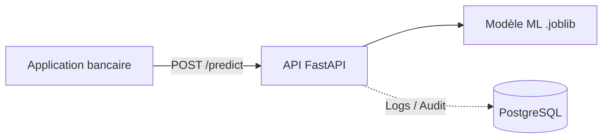

# CREDIT-RISK-API

> API FastAPI de prédiction du risque de défaut de crédit. Le modèle calcule la probabilité de défaut d'un client pour le mois suivant. Testez l'API : https://credit-risk-api-05hd.onrender.com/docs

*Le projet utilisant la version gratuite de Render, la première requête peut prendre environ une minute, le temps que le service se réveille.*

> ***Stack*** : Python 3.12, FastAPI, scikit-learn, PostgreSQL 17, Docker Compose, GitHub Actions, Render.

---

## 1. Fonctionnalités

Le système expose un ensemble de services :
- **Prédiction de défaut** : Calcul de probabilité de défaut de crédit pour le mois suivant.
- **Audit trail** : Enregistrement de chaque prédiction en base de données pour l'audit.
- **Validation des entrées** : Contrôle de la crédibilité des données envoyées à l'API.
- **Gestion d'erreurs** : Logs d'erreurs datés.

---

## 2. Démarrage Rapide avec Docker

### Prérequis
- Docker installé
- Copier le contenu du fichier `.env.example` dans un fichier `.env` pour avoir les variables d'environnement :
```bash
cp .env.example .env           # Sur Linux / macOS
Copy-Item .env.example .env    # Sur Windows (PowerShell)
```

### Démarrage
Lancez l'ensemble de l'architecture (Application + Base de données PostgreSQL) en une seule commande :
```bash
docker compose up --build
```

> Une fois que le service tourne bien, allez sur http://localhost:8000/docs dans votre navigateur.

### Exécution des Tests

- Créez un environnement virtuel Python :
```bash
python -m venv .venv
```

- Activez-le :
```bash
source .venv/bin/activate     # Linux / macOS
.\.venv\Scripts\activate      # Windows (PowerShell)
```

- Installez les bibliothèques Python de `requirements-dev.txt` :
```bash
pip install -r requirements-dev.txt
```

- Pour lancer la suite de tests unitaires et d'intégration :
```bash
python -m pytest
```

---

## 3. Modèle

### Données

- **Source** : https://www.kaggle.com/datasets/uciml/default-of-credit-card-clients-dataset
- **Nombre de clients** : 30 000
- **Pays** : Taïwan
- **Année** : 2005

---

### Algorithme et réglages

Le modèle se base sur une forêt aléatoire (*Random Forest*). Paramètres principaux du modèle :

- **200 arbres** : Le nombre d'arbres de décision dans la forêt.
- **Graine de hasard (`random_state=42`)** : Pour réentraîner exactement le même modèle de manière reproductible.
- **Au moins 50 clients par feuille (`min_samples_leaf=50`)** : Oblige chaque réponse finale d’un arbre à s’appuyer sur au moins 50 clients, au lieu d’un seul. Ceci empêche l'apprentissage par cœur (*overfitting*) de la part du modèle.

---

### Métriques d'évaluation

- **Accuracy (Exactitude) à 0,82** : Mesure le pourcentage global de bonnes réponses du modèle (82 %). Cette mesure est trompeuse dans notre cas, car les données sont déséquilibrées et la grande majorité des clients remboursent leur crédit. Un modèle qui répond toujours “rembourse” obtient déjà 0,78.
- **Precision (Précision) à 0,68** : Sur 100 clients que le modèle prédit en défaut, 68 font réellement défaut (et 32 sont de fausses alertes qui auraient remboursé).
- **Recall (Rappel) à 0,35** : Sur 100 clients qui feront réellement défaut, le modèle parvient à en repérer 35 (et en laisse passer 65).
- **AUC à 0,79** : Si l'on prend au hasard deux clients (un qui fera défaut et l'autre qui remboursera), il y a 79 % de chances que le modèle attribue une probabilité de défaut plus élevée au client qui fera effectivement défaut.

---

### Limites

- **Un Rappel (Recall) trop faible** : Le modèle ne détecte que 35 % des clients qui feront réellement défaut. Cela signifie que 65 % des mauvais payeurs passent entre les mailles du filet, ce qui expose l'établissement à un risque financier important. Comme l’API renvoie une probabilité, la banque peut choisir d’alerter dès 0,3 au lieu de 0,5 (baisser le seuil de probabilité). Elle repérera plus de défauts, en échange de plus de fausses alertes.
- **Un problème de déséquilibre des données** : Les clients qui remboursent étant largement majoritaires, la classe « défaut » est sous-représentée dans les données d'entraînement. Le modèle a donc moins d'exemples pour apprendre les signaux d'alerte, ce qui explique pourquoi une Accuracy de 0,82 donne une fausse impression de performance.
- **Un problème de représentativité** : Le modèle s'entraîne sur des clients de Taïwan en 2005, et non de Dakar en 2026. Ces données ne reflètent pas forcément les comportements financiers de cet environnement.

---

## 4. Endpoints

| Méthode | Chemin | Description | Code Succès |
| :--- | :--- | :--- | :--- |
| **GET** | `/health` | Vérifie l'état de santé de l'API | `200 OK` |
| **POST** | `/predict` | Calcule la probabilité de défaut de paiement d'un client | `200 OK` |

---

### Exemples de requêtes (cURL)

Ouvrez votre terminal (Linux / macOS) pour interagir avec l'API locale lancée sur le port `8000`. 

> **Note pour les utilisateurs Windows :** Il est recommandé d'utiliser l'interface interactive Swagger accessible via la page de FastAPI (`http://127.0.0/docs`).

```bash
curl -X 'POST' \
  'http://127.0.0.1:8000/predict' \
  -H 'accept: application/json' \
  -H 'Content-Type: application/json' \
  -d '{
  "LIMIT_BAL": 150000,
  "SEX": 1,
  "EDUCATION": 1,
  "MARRIAGE": 2,
  "AGE": 27,
  "PAY_0": 0,
  "PAY_2": 0,
  "PAY_3": 0,
  "PAY_4": 0,
  "PAY_5": 0,
  "PAY_6": 0,
  "BILL_AMT1": 86009,
  "BILL_AMT2": 86108,
  "BILL_AMT3": 89006,
  "BILL_AMT4": 89775,
  "BILL_AMT5": 87725,
  "BILL_AMT6": 40788,
  "PAY_AMT1": 4031,
  "PAY_AMT2": 10006,
  "PAY_AMT3": 3266,
  "PAY_AMT4": 4040,
  "PAY_AMT5": 1698,
  "PAY_AMT6": 800
}'
```

**Réponse attendue :**

```json
{
  "probabilite_defaut": 0.0817371459185065
}
```

> **Validation des entrées :** En cas de données incohérentes dans la requête (par exemple, un âge hors limites comme `14`), l'API renvoie un code d'erreur `422 Unprocessable Entity` accompagné des détails de l'anomalie.
>
> **Référence des données :** La signification détaillée de chaque champ est disponible sur la [page Kaggle du jeu de données](https://www.kaggle.com/datasets/uciml/default-of-credit-card-clients-dataset).

---

## 5. Architecture



---

## 6. Choix de conception

* **Stratégie *Fail-Open* :** En cas de dysfonctionnement d'un composant non critique, le service principal reste opérationnel. L'enregistrement des prédictions en base de données étant secondaire, une panne de cette base ne doit pas bloquer le fonctionnement global de l'API. Le compromis assumé est que l'historique d'audit peut présenter des trous, même si chaque échec d'écriture est consigné dans les logs au niveau `ERROR`. À l'inverse, une approche *fail-closed* (bloquant l'API en cas de panne de la base) s'imposerait si un régulateur exigeait une traçabilité stricte et exhaustive de chaque décision de crédit.

